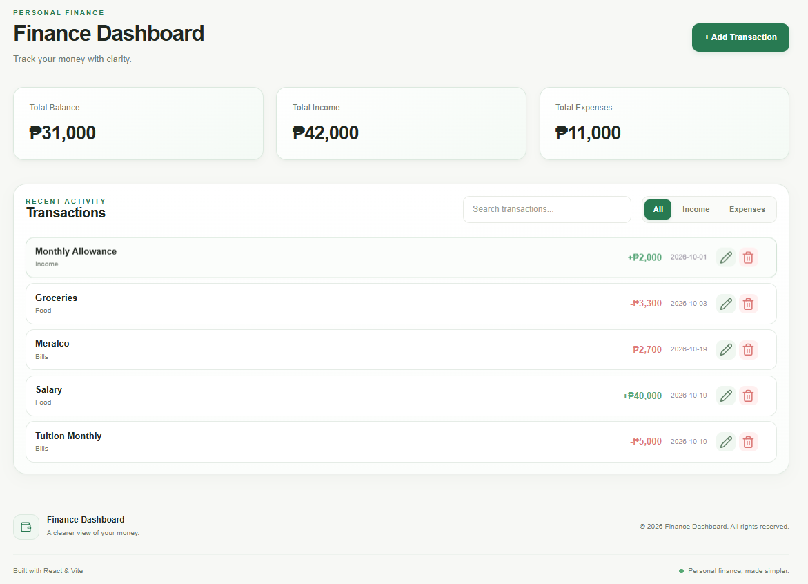

# Finance Dashboard

A modern, responsive personal finance dashboard built with **React and Vite**. Track income and expenses, manage transactions, and get a clearer view of your money through a clean, intuitive interface.

<p align="center">
  <a href="https://finance-dashboard-muieowj5y-melvin-cc36.vercel.app/">
    <strong>🚀 Live Demo</strong>
  </a>
</p>

## 📸 Preview



## ✨ Features

- **Financial Summary** — View your total balance, income, and expenses at a glance.
- **Transaction Management** — Add, edit, and delete transactions.
- **Search Transactions** — Find transactions quickly by searching.
- **Filter Transactions** — Filter transactions by type.
- **Confirmation Dialogs** — Confirm deletions before removing transactions.
- **Toast Notifications** — Receive feedback when transactions are added, updated, or deleted.
- **Persistent Storage** — Keep transaction data saved in the browser using `localStorage`.
- **Responsive Design** — Enjoy a consistent experience on desktop, tablet, and mobile.
- **Modern UI** — A clean interface with a cohesive green color palette.

## 🛠️ Built With

- React
- Vite
- JavaScript (ES6+)
- CSS3
- Lucide React — icons
- React Hot Toast — notifications
- Browser `localStorage` — data persistence

## 🚀 Getting Started

Follow these steps to run the project locally.

### Prerequisites

- [Node.js](https://nodejs.org/)
- npm (included with Node.js)
- Git

### Installation

1. Clone the repository:

   ```bash
   git clone https://github.com/Melvin-12143031/finance-dashboard.git
   ```

2. Navigate to the project directory:

   ```bash
   cd finance-dashboard
   ```

3. Install dependencies:

   ```bash
   npm install
   ```

4. Start the development server:

   ```bash
   npm run dev
   ```

5. Open the local URL shown in your terminal.

### Production Build

To create an optimized production build, run:

```bash
npm run build
```

To check the code with ESLint, run:

```bash
npm run lint
```

## 📁 Project Structure

```text
finance-dashboard/
├── public/
│   ├── favicon.png
│   └── screenshot.png
├── src/
│   ├── components/
│   │   ├── AppToaster.jsx
│   │   ├── DashboardHeader.jsx
│   │   ├── DeleteTransactionDialog.jsx
│   │   ├── Footer.jsx
│   │   ├── SearchBar.jsx
│   │   ├── SummaryCards.jsx
│   │   ├── TransactionFilter.jsx
│   │   ├── TransactionForm.jsx
│   │   ├── TransactionItem.jsx
│   │   ├── TransactionList.jsx
│   │   └── TransactionModal.jsx
│   ├── data/
│   │   └── transactions.js
│   ├── hooks/
│   │   └── useLocalStorage.js
│   ├── App.css
│   ├── App.jsx
│   ├── index.css
│   └── main.jsx
├── .gitignore
├── eslint.config.js
├── index.html
├── package.json
└── vite.config.js
```

## 💾 Data Storage

The application uses the browser's `localStorage` to persist transaction data between visits and page refreshes.

**Note:** Transactions are stored locally in the current browser. They are not synced across devices or user accounts, and clearing browser storage may remove the saved data.

## 🌐 Deployment

- **Live Demo:** [Finance Dashboard](https://finance-dashboard-muieowj5y-melvin-cc36.vercel.app/)
- **Source Code:** [GitHub Repository](https://github.com/Melvin-12143031/finance-dashboard)
- **Hosting:** Vercel

## 👨‍💻 Author

**Melvin**

Explore more of my projects on [GitHub](https://github.com/Melvin-12143031).

---

*Built with React, Vite, and a focus on clean UI, reusable components, and responsive design.*
